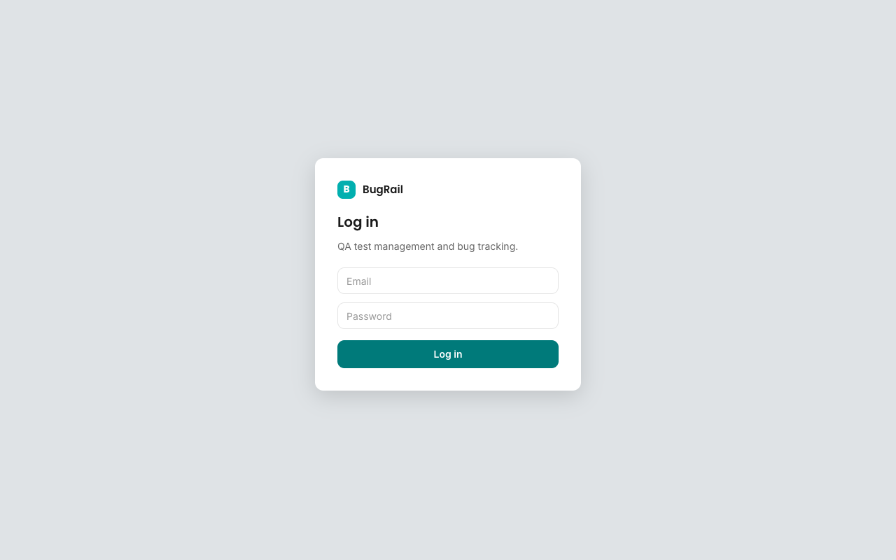
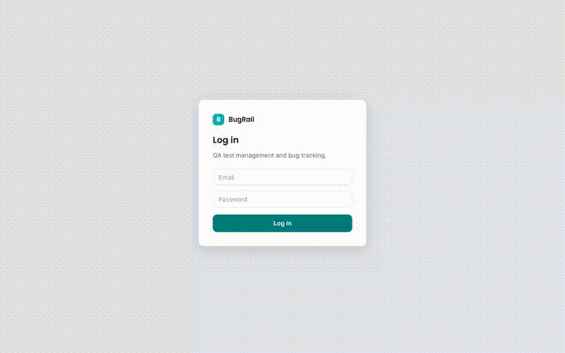
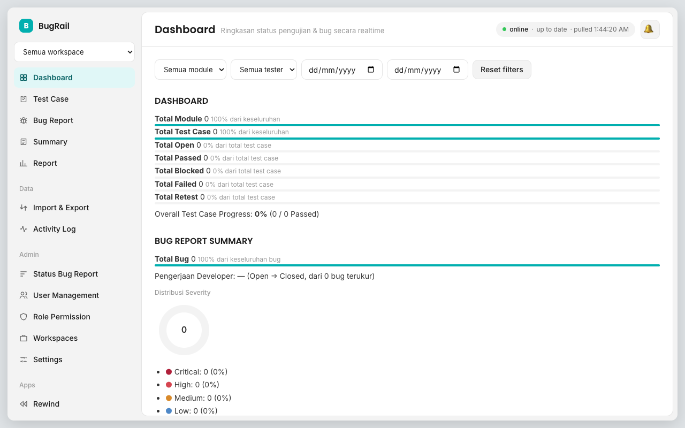
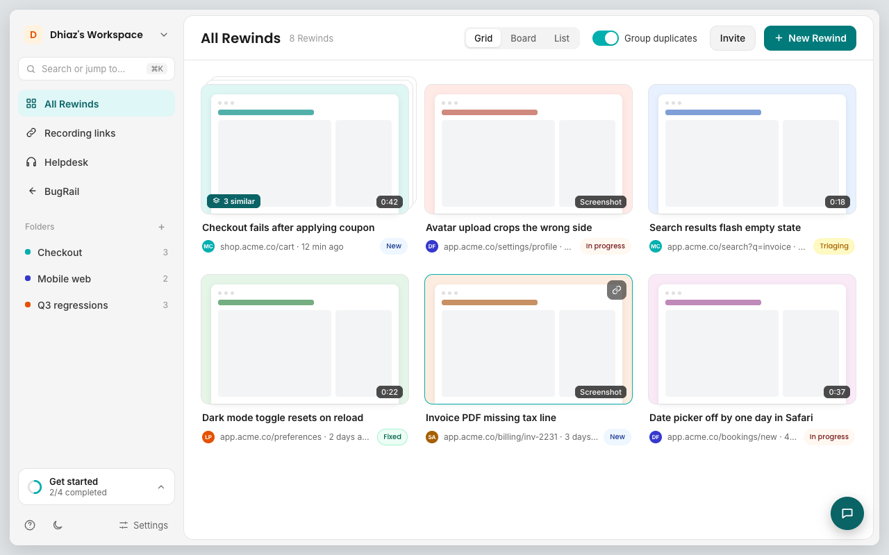

# Vercel + Turso deploy evidence (ADR-006)

| Item | Value |
|---|---|
| Preview | `bugrail-rn0zepm6w-envision-labs-projects-71c0945a.vercel.app` (Vercel SSO-protected + Basic Auth) |
| Production | `bugrail-two.vercel.app` (Basic Auth) |
| Turso | `bugrail` (Production), `bugrail-preview` (Preview, local dev) |

## Steps

1. `bun scripts/bootstrap-turso.ts` against both DBs: migrated to schema 5, first admin created ([bootstrap.log](bootstrap.log)).
2. Vercel env set for Production and Preview: `TURSO_DATABASE_URL`, `TURSO_AUTH_TOKEN`, `SESSION_PASSWORD`, `BUGRAIL_TRUSTED_PROXY`, `BASIC_AUTH_USER`, `BASIC_AUTH_PASSWORD`.
3. `vercel deploy` (preview) ([vercel-preview-deploy.log](vercel-preview-deploy.log)).
4. `scripts/verify-deploy.sh <url> bugrail-preview`: 10/10 PASS ([http-verification-preview.log](http-verification-preview.log)). Covers 401 without/with wrong Basic Auth, /login redirect, bad and good login, session, admin write landing as a row in Turso.
5. Real Chrome (Playwright) login flow, screenshots and video ([browser-preview.log](browser-preview.log)).

| Login | Dashboard after login | /rewind |
|---|---|---|
|  |  |  |

Video: [preview-flow.mp4](preview-flow.mp4), 

Console errors on preview come from Vercel Deployment Protection redirecting the service worker fetch, which does not carry the bypass header; production has no SSO protection.

## Production (after squash merge of #18)

1. `vercel deploy --prod` from merged `main` with `web/.vercelignore` so the local `.env` is never uploaded ([vercel-production-deploy.log](vercel-production-deploy.log)).
2. `scripts/verify-deploy.sh https://bugrail-two.vercel.app bugrail`: 10/10 PASS ([http-verification-production.log](http-verification-production.log)).
3. Real Chrome login flow ([browser-production.log](browser-production.log)), video [production-flow.mp4](production-flow.mp4).

| Login | Dashboard after login | /rewind |
|---|---|---|
|  |  |  |
